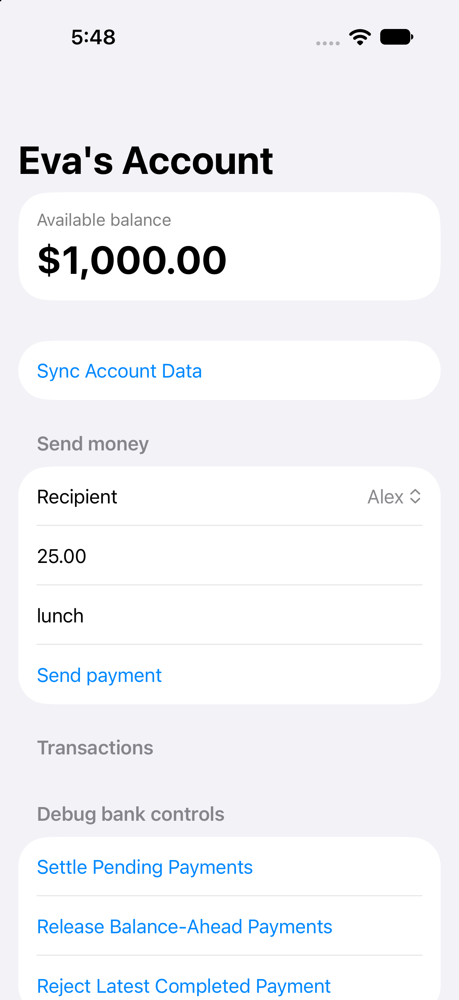

# Project Title

This project is a demonstration banking app that syncs transactions and balances with a fake bank backend. It focuses on reliability, robust error handling, and state recovery. The app ensures that every action is persisted and recoverable, aligning with real-world banking app needs.

## Home Screen

Below is a preview of the main screen of the app:

## Features
- View account balance and transaction feed
- Initiate payments to other accounts
- Robust error handling and clear user feedback on payment state
- Sync with the backend to update balance and transactions
- Persistent local state: Recovers all important information after relaunch
- Retry unsent or failed payments manually

## Getting Started
1. Clone the repository
2. Open the project in Xcode
3. Build and run

---

## How It Works

- **Feed and Balance Sync**: The app fetches the latest balance and transaction feed from the server. If the connection is lost, the user sees a warning, and the last known balance is shown until sync is restored.
- **Payment Flow**: Payments are initiated with unique idempotency keys to prevent duplicates. If a payment fails mid-flight or the network is lost, the app clearly shows the user the next steps (retry or verify via sync).
- **Persistence**: All important app state (transactions, balance, local payment state, etc.) is saved to disk, ensuring recovery after app termination. On relaunch, ambiguous payments remain visible until a sync confirms their outcome; unsent payments require explicit retry.
- **Error Handling**: The interface provides clear feedback for various network and server-side errors, ensuring users always know the state of their account and payments.

For more project details and design notes, see `NOTES.md`.
